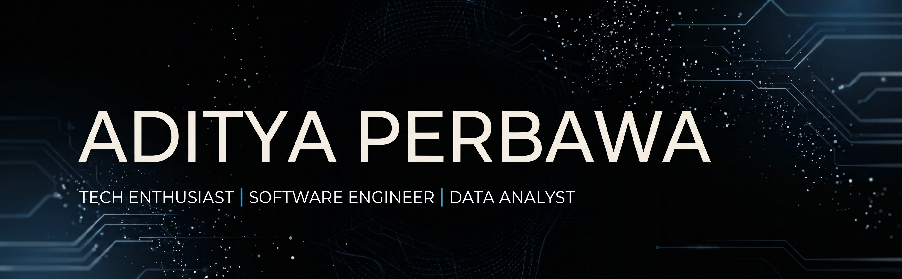

  

  <h1>Hello World 👋</h1>
  
  

### 🛠️ Skills

  <!-- Skillicons (Ikon Kotak) -->
  

  <!-- Web Development -->
  
  
  
  
  
   
  <!-- Data Analyst & Software Engineering -->
  
  
  
  
   
  <!-- IT Networking & Infrastructure -->

### 🤝 Connect with me

  
  

